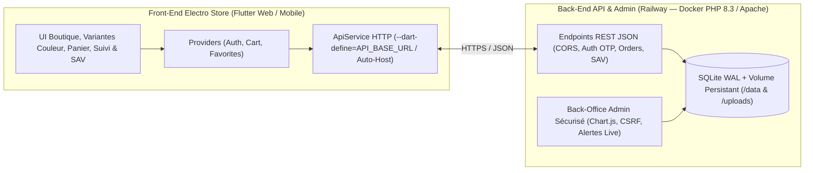

<div align="center">

# ⚡ Electro Store — Full-Stack E-Commerce (Flutter & PHP/SQLite)

**Boutique high-tech moderne multi-plateforme (Web & Mobile) avec gestion avancée des variantes couleur/image, Ventes Flash temps réel, coupons, suivi de commandes et centre Support & SAV.**

<p>
  
  
  
  
  
  
</p>

</div>

---

## 🧭 Architecture Globale



---

## ✨ Fonctionnalités Principales

### 🛍️ Côté Client (`Ecom_flutter`)
- **Accueil & Catalogue (`HomeScreen`) :**
  - Carrousel promotionnel auto-play et section **Ventes Flash** avec compte à rebours dynamique et jauge de stock.
  - Filtrage par catégories, recherche temps réel, **6 modes de tri** et panneau de **filtres avancés** (`RangeSlider` budget, note minimale, flash uniquement, en stock).
  - Bascule **Vue Grille / Vue Liste** et section **Consultés récemment**.
  - **Pastilles couleur interactives** directement sur chaque carte produit pour prévisualiser l'image de la couleur choisie et l'ajouter au panier.
- **Fiche Produit (`DetailsScreen`) :**
  - Galerie photo multi-images : sélectionner une couleur fait défiler automatiquement vers la photo associée à cette variante.
  - Système d'**Avis & Notations** clients (1 à 5 étoiles) et accès rapide au support SAV pré-rempli avec l'article.
- **Panier & Commande (`CartScreen`, `CheckoutDialog`) :**
  - Aperçu de l'image correspondant à la couleur choisie pour chaque ligne du panier.
  - Application instantanée de **codes coupons** (pourcentage ou montant fixe) et choix du paiement (**Paiement à la livraison / COD** ou **Carte Bancaire CMI**).
- **Compte, Parrainage & Suivi (`ProfileScreen`, `OrdersScreen`) :**
  - Inscription, connexion, confirmation email par code OTP et réinitialisation du mot de passe.
  - Programme de **parrainage** avec code personnel et calcul des gains.
  - Historique des commandes, **facture détaillée** et timeline de suivi en 4 étapes.
- **Centre Support Client, Pannes & SAV (`SupportScreen`) :**
  - Interface organisée en **3 onglets** :
    1. **Signaler / Contacter :** catégories visuelles, niveau d'urgence (`normale` / `urgente`) et sélecteurs déroulants pour lier un article ou une commande.
    2. **Mes Tickets :** filtres par statut, barre de progression 3 étapes (`Reçu` → `Diagnostic` → `Résolu`), ajout de précisions client et clôture du ticket.
    3. **FAQ & Garantie :** engagements garantie 24 mois, échange 7 jours et réponses rapides.

### 🛠️ Côté Back-End & Admin (`ecom_api` sur Railway)
- API REST JSON PHP 8.3 connectée à **SQLite** (mode WAL, `PRAGMA foreign_keys = ON`, protection `.htaccess` HTTP `403`).
- Back-Office Admin sécurisé (sessions durcies, bcrypt, protection anti brute-force, jetons CSRF, journal d'audit) avec **Chart.js**, alertes live de nouvelles commandes, gestion multi-images & image par couleur, gestion des clients (activation/suspension), édition des articles de commande et traitement SAV.

---

## 📁 Structure du Projet

```text
Ecom_flutter/
├── lib/
│   ├── main.dart                         # Point d'entrée & Providers
│   ├── constans.dart                     # Palette & constantes UI Electro Store
│   ├── models/                           # Product, ProductColor, CartItem, Order, Coupon, Review, SupportTicket, User
│   ├── providers/                        # AuthProvider, CartProvider, FavoriteProvider
│   ├── services/
│   │   └── api_service.dart              # Client REST (support --dart-define=API_BASE_URL & détection hôte Web)
│   ├── screens/
│   │   ├── auth/                         # Login, Register, VerifyEmail (OTP), ForgotPassword
│   │   ├── home/                         # Catalogue, Flash Sales, filtres & pastilles couleurs
│   │   ├── details/                      # Galerie multi-images, variantes couleurs, avis
│   │   ├── cart/                         # Panier, coupons & CheckoutDialog
│   │   ├── favorites/                    # Liste des favoris
│   │   ├── orders/                       # Suivi de commandes & facture
│   │   ├── profile/                      # Profil, parrainage & raccourcis
│   │   └── support/                      # Centre Support & SAV à 3 onglets
│   └── widgets/
│       └── product_image.dart            # Rendu unifié assets locaux / URLs réseau / uploads API
├── scripts/
│   └── vercel_build.sh                   # Script de build Flutter Web pour Vercel
├── vercel.json                           # Configuration Vercel (SPA rewrites & headers sécurité)
└── pubspec.yaml
```

---

## 🛠️ Stack & Dépendances

| Couche | Technologies |
| :--- | :--- |
| **Front-End** | Flutter (Web & Mobile), Dart (`>=2.16.0 <4.0.0`), Material Design |
| **Gestion d'état** | `provider` (`^6.1.5+1`) |
| **Réseau & Stockage local** | `http` (`^1.2.2`), `shared_preferences` (`^2.2.3`) |
| **Back-End & Base de données** | PHP 8.3, Apache, SQLite (WAL) *(hébergé sur Railway)* |
| **Déploiement Front-End** | Vercel (`vercel.json` + `scripts/vercel_build.sh`) |

---

## 🚀 Installation & Lancement Local

### Prérequis
- [Flutter SDK](https://docs.flutter.dev/get-started/install) installé et configuré
- Serveur API `ecom_api` accessible (en local via WAMP/Apache ou via l'URL Railway)

### 1. Cloner et installer les dépendances
```bash
git clone https://github.com/hamzamachnaoui/Ecom_flutter.git
cd Ecom_flutter
flutter pub get
```

### 2. Lancer en développement
- **Avec l'API locale (WAMP / localhost) :**
  ```bash
  flutter run -d chrome
  ```
- **En pointant directement vers l'API déployée sur Railway :**
  ```bash
  flutter run -d chrome --dart-define=API_BASE_URL=https://ecom-api-production-b834.up.railway.app
  ```

### 3. Compiler pour la production Web
```bash
flutter build web --release --base-href "/" --dart-define=API_BASE_URL=https://ecom-api-production-b834.up.railway.app
```

---

## ☁️ Déploiement sur Vercel

Ce dépôt est directement prêt pour **Vercel** via [vercel.json](vercel.json) et [scripts/vercel_build.sh](scripts/vercel_build.sh) :

1. Importez `hamzamachnaoui/Ecom_flutter` dans **Vercel**.
2. Ajoutez la variable d'environnement dans **Project Settings → Environment Variables** :
   - **`API_BASE_URL`** = `https://ecom-api-production-b834.up.railway.app`
3. Déployez : Vercel installe automatiquement Flutter `stable`, compile l'application Web et applique le routage SPA.

---

## 👤 Auteur & Contact

Développé par **Mohamed Hamza Machnaoui**

<p>
  <a href="https://ma.linkedin.com/in/mohamed-hamza-machnaoui">
    
  </a>
  <a href="https://facebook.com/hamza.machnaoui">
    
  </a>
  <a href="https://github.com/hamzamachnaoui">
    
  </a>
</p>
